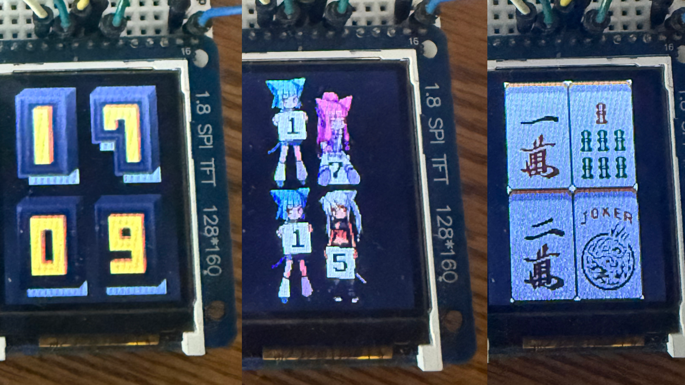

# ESP32 Customizable Clock



A digital clock that you can easily customize with your own
themes. Use a web app frontend to preview and upload assets, and watch
the clock update live.

## Highlights
- Wi-Fi connectivity for easy access to device.
- Persistent digit themes (survives reboots) stored as RGB565 image data.
- Intuitive React-based web app to manage theme assets and clock appearance.
- Web app hosted directly on the ESP32

## Hardware
- Microcontroller: ESP32-C6
- Display: ST7735 TFT (128 x 160 pixels)

To recreate it on a breadboard, the pin connections are:

| ST7735         | ESP32-C6 |
|----------------|----------|
| `PIN_SPI_SCK`  | 19       |
| `PIN_SPI_MISO` | 20       |
| `PIN_SPI_MOSI` | 18       |
| `PIN_TFT_CS`   | 17       |
| `PIN_TFT_DC`   | 1        |
| `PIN_TFT_RST`  | 0        |

I will be creating and publishing a full PCB for this soon as well.

## Setup and How to Use

### Firmware Configuration and Installation

#### 1. Set Wi-Fi credentials
Wi-Fi credentials are currently set via a user configured file,
`esp32/clock-firmware/include/wifi_config.h` in the form:

	#ifndef WIFI_CONFIG_H
	#define WIFI_CONFIG_H

	#define WIFI_SSID "[insert SSID here]"
	#define WIFI_PASSWORD "[insert password here]"

	#endif
	
This will be updated to an interactive process soon.

#### 2. Build, flash, and monitor
The device firmware is compiled and flashed with PlatformIO. The
frontend is built with `npm`.

First, build the frontend:

```
./scripts/build_frontend.sh
```

Then, from `esp32/clock-firmware/`:

	pio run -t upload -t monitor

## Run the Web App
	
On a device connected to the same network as the ESP32, use a browser
to go to (http://esp-clock). From here, you can directly upload images
to represent digits 0-9 on the clock face.

The other modules on this page are a preview, for features that will
be added later!

